<p align="center"></p>
<h1 align="center">Orazio</h1>
<p align="center"><b>A self-hosted market terminal for Indian and global markets. For quants, by quants.</b></p>

<p align="center">
Closing Auction Session (CAS) terminal · research hub (flows, gamma exposure, rotation, correlation, seasonality, rates, macro) · Bloomberg-style command line · alerts with backtests · drawing tools · bar replay · screener · options · bonds for 37 countries · spot and futures commodities<br>
<b>No login, no API keys, nothing to pay for.</b> Runs on your machine from public exchange data (NSE, BSE, CCIL and more).
</p>

<p align="center">
<a href="#quick-start">Quick start</a> ·
<a href="#charting-and-drawing">Charting</a> ·
<a href="#bar-replay">Replay</a> ·
<a href="#screener">Screener</a> ·
<a href="#options">Options</a> ·
<a href="#insights">Insights</a> ·
<a href="#command-line">Commands</a> ·
<a href="#closing-auction-session-cas-terminal">CAS</a> ·
<a href="#bonds">Bonds</a> ·
<a href="#commodities-spot-and-futures">Commodities</a> ·
<a href="#where-the-data-comes-from">Data sources</a> ·
<a href="#limits-measured">Limits</a>
</p>

<p align="center"><a href="docs/demo.mp4">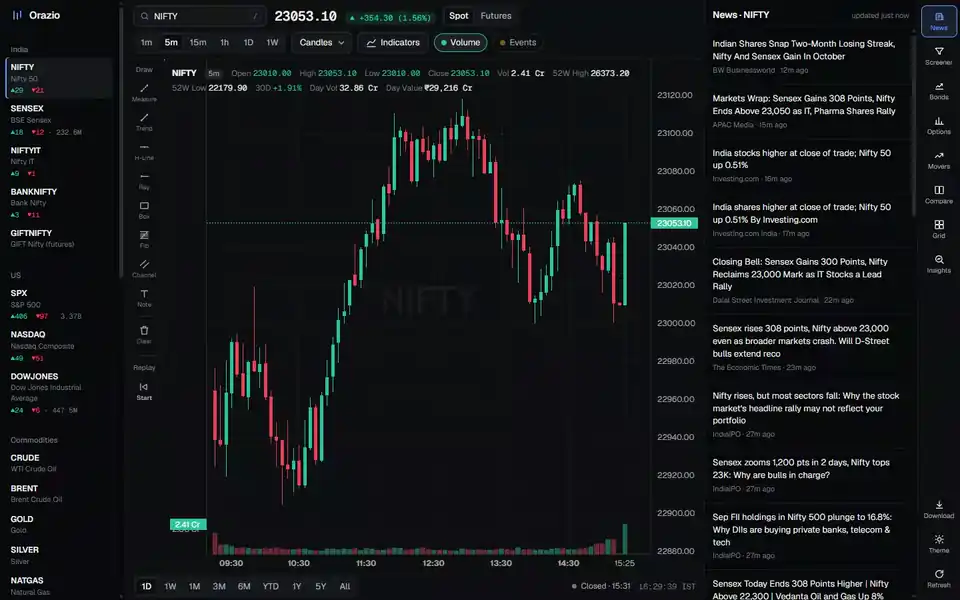</a></p>
<p align="center"><b><a href="docs/demo.mp4">▶ Watch the full demo (1:50, MP4)</a></b> · the preview above plays at 2× speed</p>

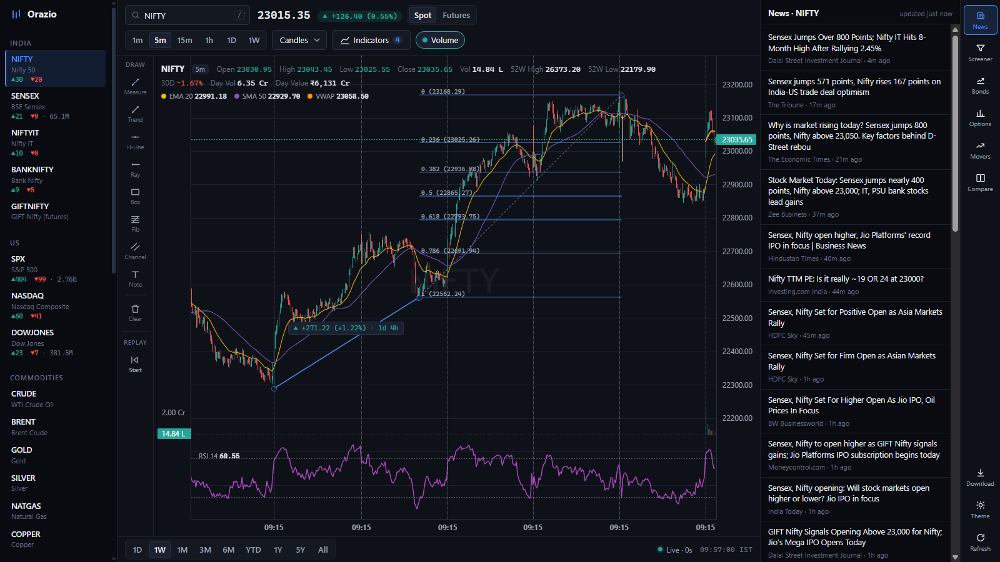

> **Educational and informational project.** Orazio is not a replacement for licensed exchange data or professional trading tools, and nothing it shows is financial advice. Data can be delayed, wrong or missing. Use it at your own risk.

## Why it's built for quants

- **Every latency is measured, not claimed.** Each number in the [data table](#where-the-data-comes-from) was timed against the exchange. Where a free source is late (CME futures on every free site run 10 minutes behind), the README says so.
- **Sources are chosen by accuracy.** The futures feed, for example, was picked by lining each candidate up against real CME/ICE trades at the same moment and keeping the one that tracks the contract most closely ([results](#commodities-spot-and-futures)).
- **Everything is inspectable.** It's plain Python and ES modules with no build step. About 1,000 tests run offline in seconds, and [tests/README.md](tests/README.md) maps every feature to the test that proves it.
- **Your data stays local.** It runs on `localhost`: no account, no telemetry, no key to leak. Download any series as CSV or Parquet.

## Quick start

```bash
pip install -r requirements.txt
python app.py          # open http://localhost:5000
```

## Charting and drawing

- **Live charts:**
  - Candles, bars, line or area; 1-minute to weekly bars.
  - Volume, and drag left for older history. Light and dark themes.
  - Prices are pushed to the page (server-sent events), not polled.
- **Indicators:**
  - Three moving averages (SMA or EMA, any length). Each can run on another timeframe, e.g. the 200-day SMA on a 5-minute chart.
  - VWAP, Bollinger Bands, RSI and MACD.
- **Drawing tools** (the labelled strip left of the chart):
  - Trendline, horizontal line, ray, box, Fibonacci retracement, parallel channel, text note and a measure tool.
  - Every drawing is anchored to price and time, so it survives pan, zoom, interval changes and reloads.
  - Drag a point to reshape a drawing, drag a line to move it, and double-click a note to edit it.
- **Compare:** a second chart beside the first, synced by time (scroll, zoom, crosshair), with both symbols' % change over the window on screen.
  - Its own style: candles, bars, Heikin Ashi, line, area or baseline.
  - **Formula series:** type `NIFTY / BANKNIFTY`, `IN10Y-IN - US10Y` (spaces around the minus) or `GOLD * INR=X`.
- **Events on the chart** (the Events toggle): results days, dividends, splits, bonuses, bulk and block deals for NSE stocks; RBI rate decisions and big FII days for Indian indices. Hover a marker to read it. Your journal trades always show as Buy/Sell markers.
- **Multi-chart grid** (Grid, right edge): 2–4 charts side by side, each with its own bar size. Leave a pane's symbol empty and it follows the main chart (one symbol on several timeframes); crosshairs are synced.

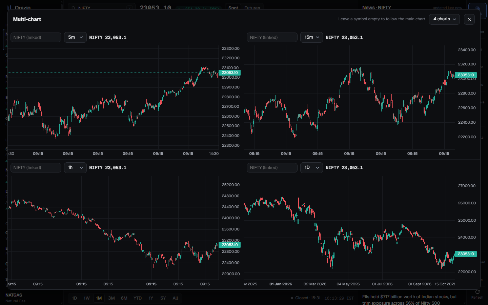

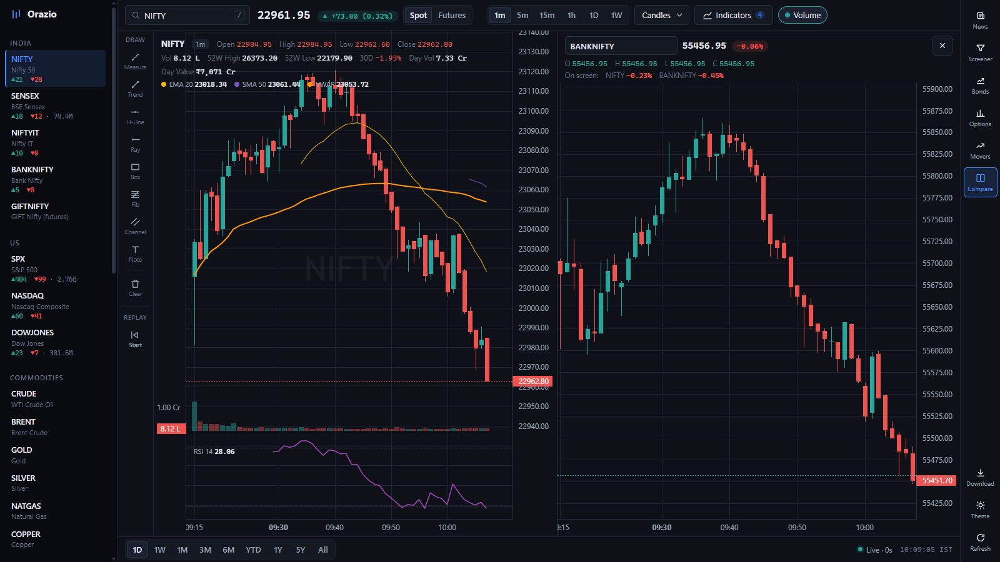

## Bar replay

Click **Replay → Start**, then click a bar, and everything after it disappears. Step one bar at a time (→) or play (Space) at 1, 3 or 10 bars a second. Indicators and drawings follow the replayed bars, and live prices stay off the chart until you press Stop.

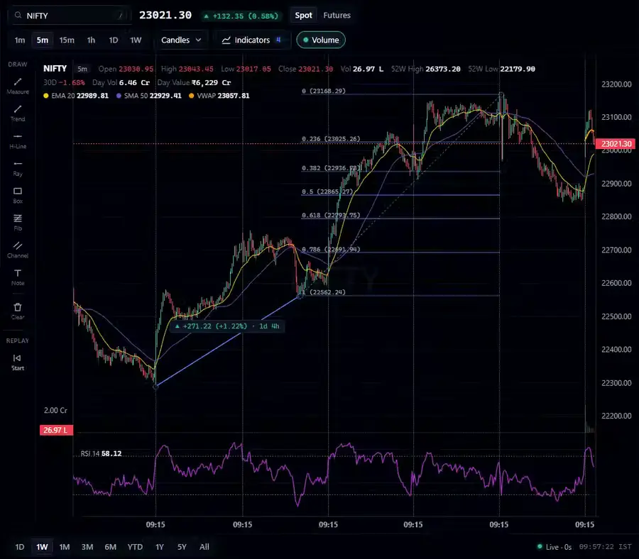

## Screener

- **Universes:** NIFTY 50, NIFTY BANK, NIFTY 500 or NIFTY Total Market (~750), from NSE's own market watch.
- **Columns:**
  - Live price, % change, traded value, distance from the 52-week high and low, 30-day and 1-year change.
  - RSI(14), distance from the 50- and 200-day SMAs, and golden or death crosses in the last 5 sessions.
- **Presets** (near 52W high, RSI < 30, above 200-day SMA, …) or your own min/max filters. Sort any column, and click a row to chart it.
- RSI and SMAs come from one daily Yahoo download (~15 s for 500 stocks), then update intraday with the live price. RSI matched the chart's own RSI exactly in testing.

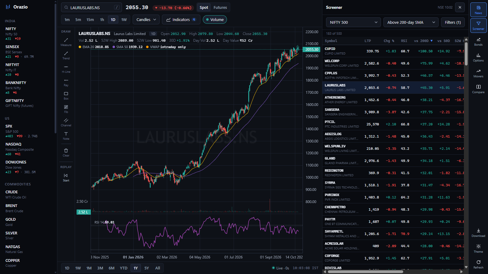

## Options

- NSE futures table and option chain for NIFTY, BANKNIFTY and ~213 F&O stocks.
- OI, change in OI (heatmap), IV, volume, PCR, max pain and ATM straddle; an IV smile chart.
- A **payoff-at-expiry builder:** click any LTP to add a leg. It shows max profit and loss, breakevens, live P&L and real lot sizes.
- Yahoo option chains for US stocks. You can also chart the front-month future instead of spot.

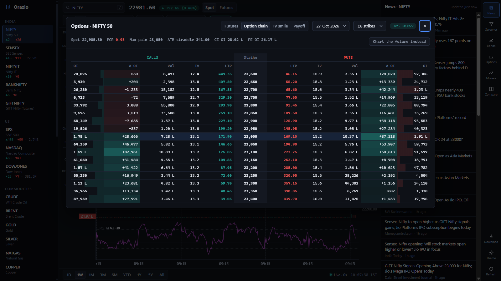

## Insights

One window (**Insights**, right edge) with a tab per research view. Click any row or tile to chart it.

- **Brief:** 14 cross-asset tiles (Indian indices, GIFT Nifty, India VIX, USD/INR, India and US 10Y, dollar index, Brent, gold, US indices, Bitcoin), the gap GIFT Nifty implies for the open, FII/DII cash, system liquidity, today's high-impact releases and the top headlines.
- **Market structure:**
  - **Flows:** FII/DII cash net, and participant-wise derivatives OI (FII, DII, Pro, Client) for 30 sessions: net index futures, FII long %, net index calls and puts.
  - **Breadth:** advance/decline, % above the 50/200-day SMA, stocks near 52-week highs and lows, RSI extremes, fresh golden/death crosses, and the spread of today's moves.
  - **Delivery & deals:** stocks whose delivered quantity jumped against their own 20-session average, and the latest bulk and block deals.
  - **Rollover:** futures rollover % and roll spread per underlying, against the previous series at the same number of sessions before expiry.
- **Options analytics:** dealer gamma exposure (GEX) by strike, the zero-gamma flip level, call and put walls, max pain, PCR, the IV smile, the ATM IV term structure across six expiries, and today's OI change by strike. Any NSE F&O underlying.
- **Quant research:**
  - **Rotation:** a relative rotation graph of 13 NSE sectors against NIFTY 50 (weekly).
  - **Correlation:** correlation or beta of daily returns across an editable cross-asset basket, over 3M to 3Y. Yields use level changes. Click a cell to compare the pair.
  - **Seasonality:** average and median return by month and weekday, with the share of positive periods, over the full history (NIFTY: since 2007).
  - **Event study:** what a symbol did 1–20 sessions after RBI hikes or cuts, big up/down days, opening gaps, or your own dates. Average path, hit rate and every event.
- **Rates and macro:**
  - **Rates:** a yield curve you can scrub back five years (16 countries) against today's; US 10Y−2Y, 10Y−3M, India−US 10Y and Bund spreads; Indian corporate bond spreads over G-secs by rating.
  - **Macro:** the week's economic calendar in IST, and RBI's daily liquidity: net injection or absorption, call/TREPS/repo rates, SDF and MSF use.
- **Your tools:**
  - **Alerts:** price, day-change, RSI and moving-average alerts that notify in the page and on the desktop. **Backtest any rule first:** how often it fired over the full history and what followed 1–20 sessions later.
  - **Watchlist:** live price and change, 52-week distance, RSI, distance from the 50/200-day SMA, volume against its 20-day average, and NSE delivery %.
  - **Journal:** log trades; see FIFO-matched P&L, win rate, profit factor, P&L by setup, the equity curve and open positions marked to market. Export to CSV.
  - **Workspaces:** save a layout (symbol, style, studies, compare, grid, panels) under a name, or start from a preset: Expiry day, Bond desk, Pre-open.

| Brief | Options analytics | Sector rotation |
|---|---|---|
| 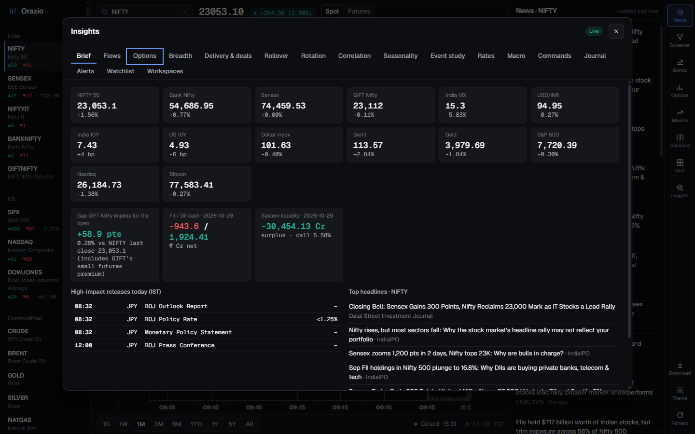 | 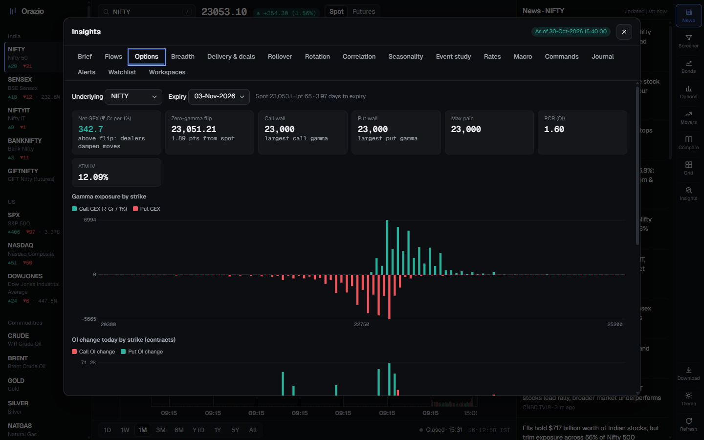 | 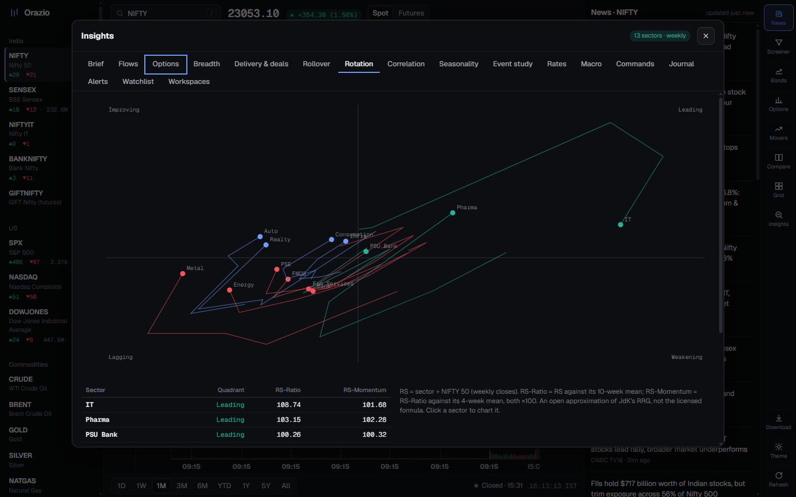 |

## Command line

Type a command in the symbol search and press Enter, Bloomberg-style. Press `:` anywhere to start one.

| Type | Does |
|---|---|
| `NIFTY OPT` · `RELIANCE SEAS` · `BANKNIFTY ROLL` | Charts the symbol and opens that view |
| `BANKNIFTY 5M` · `NIFTY 1W` | Charts it at that bar size |
| `NIFTY CMP SPX` · `CMP IN10Y-IN - US10Y` | Opens Compare with a symbol or a formula |
| `:FLOW` · `:BRIEF` · `:ECO` · `:WS` | A view on its own (single words need the colon) |
| `:HELP` | Lists every function and its aliases |

## Closing Auction Session (CAS) terminal

- **Overview:** a countdown, live NIFTY / BANKNIFTY / NIFTY IT / SENSEX movement, and a stock-by-stock auction feed with order books.
- **Real-time auction estimate** for NIFTY, BANKNIFTY and NIFTY IT, rebuilt every 2 s from their stocks:
  - It starts from NSE's own auction price for each stock. Between NSE's prints it's carried forward by BSE's live auction on the same stocks: the 30 SENSEX stocks over BSE's socket (~0.7 s), the rest from BSE's market watch.
  - Each index is rebuilt with NSE's own free-float weights, refined daily against a week of 1-minute data. On a day the fit hadn't seen it was off by ~1 pt for NIFTY, ~3 for NIFTY IT and ~18 for BANKNIFTY.
- **Futures-implied close** for NIFTY and BANKNIFTY:
  - Index futures trade until 15:40, through the auction, so the front-month future minus its 15:14:59 basis estimates where the close is heading.
  - It's available from 15:15, before NSE's own index indicative appears (~15:20).

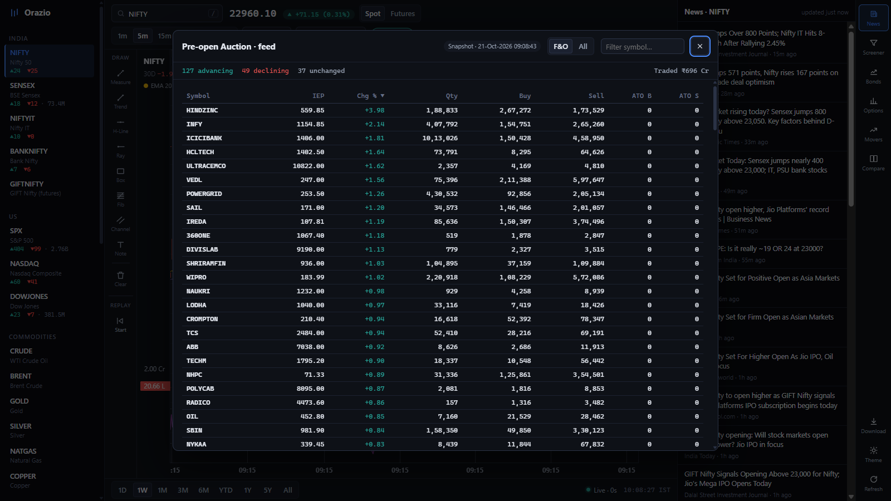
<sub>The same feed outside the closing auction, showing that morning's pre-open session (21 Oct 2026, 09:08).</sub>

## Bonds

**Global:**
- Government bond yields for **37 countries**, every maturity CNBC carries: 161 in all, including the full US, German, Japanese and Italian curves.
- Real time, grouped by region. Open a country to see its whole curve, and click any maturity to chart it.

**India:**
- **Live from CCIL's NDS-OM** (the RBI's own G-sec trading platform): ~80 central government G-secs, ~150 state development loans, ~40 T-bills and when-issued. Each row shows last traded yield and price, best bid and offer, and traded volume.
- **~570 NSE-listed corporate bonds** with rating, coupon, maturity, price and an approximate yield to maturity.

**Charts:**
- Yields chart with the full toolset (drawings, indicators, replay), at 3 decimals, with changes in basis points.
- Intraday bars from CNBC: 1-minute for about a week, 5- and 15-minute for about 40 days, hourly for about 3 months. Daily and weekly bars go back decades.
- India's 10Y has daily history from 2015 (worldgovernmentbonds.com).
- CCIL only shows today, so Orazio records every G-sec trade while it runs. Each security's chart starts on the day Orazio first saw it trade.

| Global yields, US curve open | India: CCIL G-secs and the 10Y since 2022 |
|---|---|
| 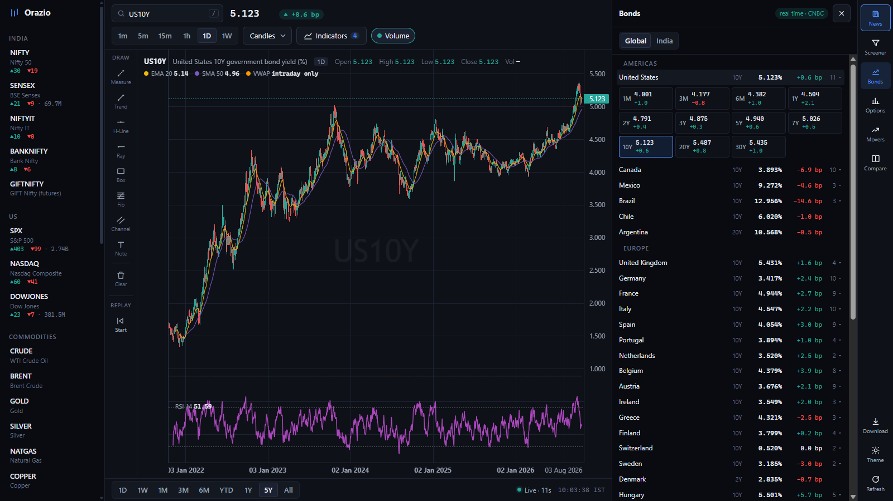 | 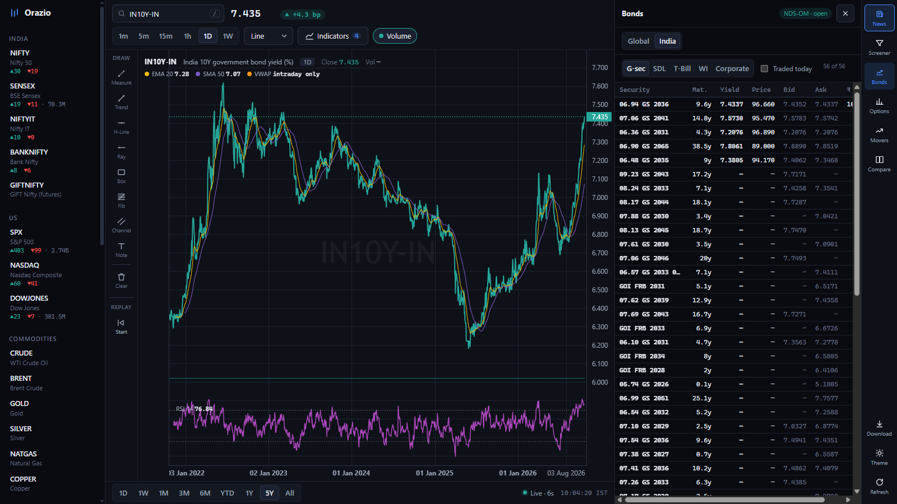 |

## Commodities: spot and futures

WTI, Brent, natural gas, copper, gold and silver, live. A switch beside the price picks **Spot** (the default) or **Futures**.

| | Spot | Futures |
|---|---|---|
| WTI, Brent | Dukascopy: matches TradingView's USOIL/UKOIL to a cent or two | Hyperliquid oracle |
| Natural gas, copper | Dukascopy front-month price | Hyperliquid oracle |
| Gold, silver | Swissquote live, Dukascopy history (agree to cents) | Binance |

Free real-time CME/ICE data doesn't exist, so futures come from perpetual contracts. The futures sources were picked by lining each candidate up against **real exchange trades at the same moment** (21 Oct 2026, 26–42 trades each):

| | Binance | Hyperliquid oracle | Contract tracked |
|---|---|---|---|
| WTI | +5.2¢ | **+0.4¢** | Dec |
| Brent | +4.4¢ | **−0.6¢** | Jan |
| Natural gas | +0.5¢ | **0.0¢** | Dec |
| Gold | **−$10.5** vs COMEX | −$18.1 (tracks spot) | — |

Type `CRUDE`, `WTI` or `USOIL` for WTI, and `BRENT` or `UKOIL` for Brent. Futures charts beyond a year use CME history via Yahoo.

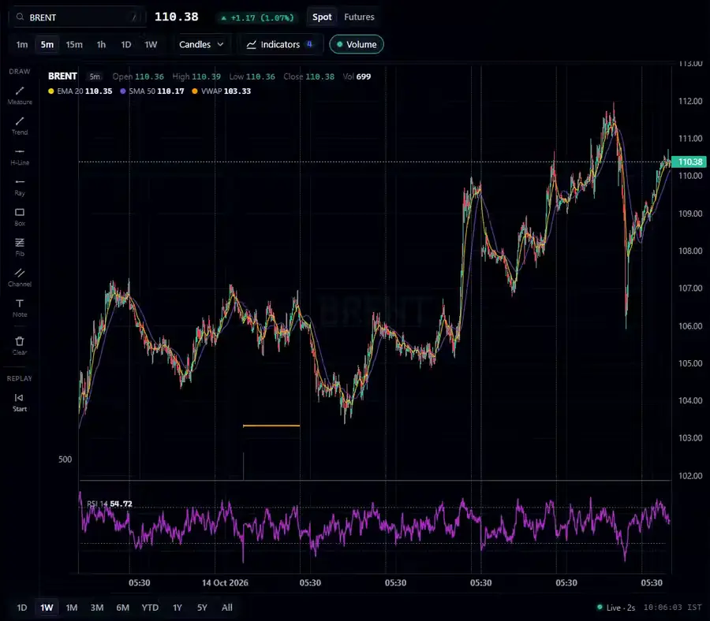

## Also included

- **SENSEX in real time** from BSE's own push stream. **GIFT Nifty**, with history back to 2023.
- **Market breadth and Top Movers** for Indian, US and Asian indices, in the left rail.
- **News panel** for the symbol on the chart. Company names, 52-week stats and live index volume in the legend.
- **Download** any series as CSV or Parquet, or schedule an end-of-day export.
- **Layout:**
  - The instrument and chart controls sit in the top bar.
  - Drawing tools and replay are in a labelled strip left of the chart.
  - The panels (News, Screener, Bonds, Options, Movers, Compare, Grid, Insights) are on the right edge.
  - Narrow screens stack everything.

## Where the data comes from

| Market | Source | Latency |
|---|---|---|
| NIFTY, BANKNIFTY, NIFTY IT | Yahoo tick, NSE for the official close | 1–5 s |
| SENSEX | BSE push stream | ~1 s |
| Commodities, spot | WTI, Brent, gas, copper: Dukascopy · gold, silver: Swissquote live + Dukascopy history | 3–8 s |
| Commodities, futures | Hyperliquid oracle (oil, gas, copper) · Binance websocket (gold, silver) · Yahoo CME for long history | ≤1 s |
| NSE futures, options, GIFT Nifty | NSE / NSE IX public endpoints | ~1 min |
| US, Korea, Taiwan, China indices | Yahoo / Sina / Naver / TWSE | seconds |
| Government yields, 37 countries | CNBC quote service | real time (measured 15–40 s since the last tick while each market trades) |
| Indian G-secs, SDLs, T-bills | CCIL NDS-OM market watch | each trade, on the next 5 s poll (CCIL's server sometimes takes ~10 s) |
| Indian corporate bonds | NSE listed-bonds feed | ~15 s |
| NSE auction (CAS) | NSE public feed | ~54 s (measured) |
| NIFTY / BANKNIFTY / NIFTY IT CAS, rebuilt | NSE's indicative print + a rebuild from each stock's auction price (NSE, then BSE) between prints | ~2 s (NSE prints ~15 s) |
| NIFTY / BANKNIFTY CAS, futures-implied | NSE front-month futures (basis held at 15:14:59) | ~54 s (measured 14 Oct 2026) |
| FII/DII cash, participant-wise OI | NSE `fiidiiTradeReact` · NSE `fao_participant_oi` archive | daily, ~6 pm IST |
| Delivery %, bulk and block deals | NSE `sec_bhavdata_full` archive · NSE large-deal API | daily, after the close |
| Rollover | NSE F&O bhavcopy (the futures history cache) | daily |
| Options analytics | NSE option chain (GEX computed here: Black-Scholes, r = 0) | polled every 30 s |
| RBI liquidity | RBI's daily "Money Market Operations" release | next morning |
| Economic calendar | ForexFactory weekly feed | hourly |

## Limits, measured

- **Public endpoints:** Orazio uses the same public endpoints the exchanges' own websites call, not supported APIs. Any of them can change or block access; the app falls back instead of erroring.
- **CAS estimate (measured on the 14 Oct 2026 auction):**
  - NSE's indicative index updated about every 15 s.
  - The raw rebuild finished +10.5 pts from NIFTY's official close, −8.6 for NIFTY IT and +56 for BANKNIFTY (mostly a constant offset from its starting level). So the estimate snaps to each NSE print and lands on NSE's own number.
  - Between prints it was no better than NSE's last print: BSE's auction doesn't lead NSE's. Treat the live line as NSE's latest value plus noise-level drift, not a forecast.
- **NSE futures** update about once a minute (quote API median 54 s; tick chart 108 s and ~30 s behind).
  - The rebuild tracks NSE's close closely rather than exactly, because BSE's auction is a separate order book. It says what share of the index has an auction price so far.
  - The futures-implied close can drift with the basis, and NIFTY IT has no index future.
- **Commodity futures are perpetuals** (see the table above). They roll on their own schedule; on 21 Oct 2026 they tracked WTI Dec, Brent Jan, gas Dec and copper Dec.
- **"Spot"** for oil, gas and copper is the front-month price trading screens show (TradingView's USOIL/UKOIL), not the physical benchmark. The official EIA Cushing spot is published about a week late.
- **Bonds:** charts of single Indian G-secs only cover days Orazio was running. Corporate-bond yields are approximate (annual coupons, simple accrued interest, call dates ignored).
- **Insights history:** NSE publishes only the latest day's FII/DII cash figures and RBI lists only its last ~8 liquidity releases, so those charts build up day by day from the first day Orazio ran. Participant OI, delivery and rollover come from archives and have history at once.
- **Gamma exposure** assumes dealers are long the calls and short the puts the public holds (the common convention). It's a positioning estimate, not a measured dealer book.
- **Economic calendar:** the free feed covers the major currencies only (no INR events) and has forecasts but no actual figures. It rate-limits, so the last good copy is kept on disk.
- **RBI decisions** built in for the event study and chart markers run from 2019 to June 2025; add newer ones as custom dates.
- **Alerts** run while the page is open, not on the server.
- **MCX:** Indian commodities aren't available, because MCX blocks scripted access and NSE has no commodity feed.
- **Flask dev server:** don't expose it to the internet.

## Tests

```bash
python -m pytest        # ~820 backend tests, a few seconds, no network
npm test                # ~210 frontend tests (logic, plus a parse check of every module), Node's built-in runner
python scripts/smoke.py # live-feed check against a running server
```

[tests/README.md](tests/README.md) maps each feature to its tests.

## How it works

One local Flask process serves the page, answers `/api/*` and polls the exchanges in background threads. The frontend is plain ES modules with no build step.

```
orazio/            backend: one module per concern (market_data, cas, fno, quotes, spot, futures, bonds, gsec, screener, flows, options_analytics, delivery, rollover, macro, ...)
orazio/routes/     HTTP routes, one file per feature area
static/js/         frontend modules; *-policy.js, *-math.js and format.js are pure and unit-tested; insights-*.js are the Insights tabs
tests/  scripts/   pytest + node tests, live smoke script
docs/screenshots/  the images in this README
```
